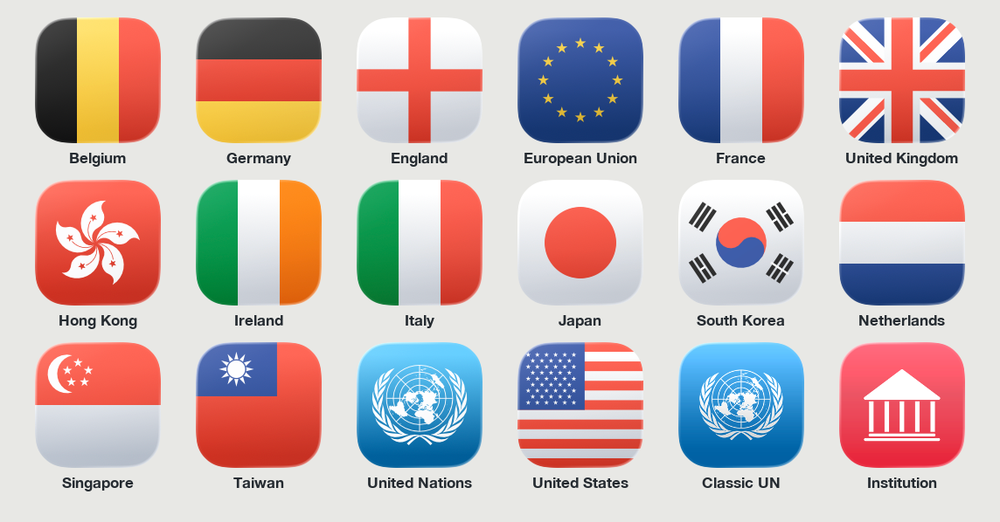

# Flag collection

[Flags.json](../Flags.json) contains the user-selected flags and two preserved historical artworks. [selection.json](selection.json) records the selections and refinements.

## macOS 26 edition

The macOS edition covers the same 18 entries. Subscribe to the [1024px catalog](../Flags-macOS.json) or the [144px catalog](../Flags-macOS144px.json). The [local review page](http://127.0.0.1:8741/review/?collection=Flags-macOS.json) shows each icon at full size and 32px.



| Icon | PNG | macOS | Editable source |
| --- | --- | --- | --- |
| Belgium | [1024px](macos/png/BEL.png) · [144px](macos/144px/BEL.png) | [ICNS][icns-bel] | [Project](macos/source/BEL.icon/) |
| Germany | [1024px](macos/png/DEU.png) · [144px](macos/144px/DEU.png) | [ICNS][icns-deu] | [Project](macos/source/DEU.icon/) |
| England | [1024px](macos/png/ENG.png) · [144px](macos/144px/ENG.png) | [ICNS][icns-eng] | [Project](macos/source/ENG.icon/) |
| European Union | [1024px](macos/png/EUR.png) · [144px](macos/144px/EUR.png) | [ICNS][icns-eur] | [Project](macos/source/EUR.icon/) |
| France | [1024px](macos/png/FRA.png) · [144px](macos/144px/FRA.png) | [ICNS][icns-fra] | [Project](macos/source/FRA.icon/) |
| United Kingdom | [1024px](macos/png/GBR.png) · [144px](macos/144px/GBR.png) | [ICNS][icns-gbr] | [Project](macos/source/GBR.icon/) |
| Hong Kong | [1024px](macos/png/HKG.png) · [144px](macos/144px/HKG.png) | [ICNS][icns-hkg] | [Project](macos/source/HKG.icon/) |
| Ireland | [1024px](macos/png/IRL.png) · [144px](macos/144px/IRL.png) | [ICNS][icns-irl] | [Project](macos/source/IRL.icon/) |
| Italy | [1024px](macos/png/ITA.png) · [144px](macos/144px/ITA.png) | [ICNS][icns-ita] | [Project](macos/source/ITA.icon/) |
| Japan | [1024px](macos/png/JPN.png) · [144px](macos/144px/JPN.png) | [ICNS][icns-jpn] | [Project](macos/source/JPN.icon/) |
| South Korea | [1024px](macos/png/KOR.png) · [144px](macos/144px/KOR.png) | [ICNS][icns-kor] | [Project](macos/source/KOR.icon/) |
| Netherlands | [1024px](macos/png/NLD.png) · [144px](macos/144px/NLD.png) | [ICNS][icns-nld] | [Project](macos/source/NLD.icon/) |
| Singapore | [1024px](macos/png/SGP.png) · [144px](macos/144px/SGP.png) | [ICNS][icns-sgp] | [Project](macos/source/SGP.icon/) |
| Taiwan | [1024px](macos/png/TWN.png) · [144px](macos/144px/TWN.png) | [ICNS][icns-twn] | [Project](macos/source/TWN.icon/) |
| United Nations | [1024px](macos/png/UN.png) · [144px](macos/144px/UN.png) | [ICNS][icns-un] | [Project](macos/source/UN.icon/) |
| United States | [1024px](macos/png/USA.png) · [144px](macos/144px/USA.png) | [ICNS][icns-usa] | [Project](macos/source/USA.icon/) |
| Classic UN | [1024px](macos/png/UN-classic.png) · [144px](macos/144px/UN-classic.png) | [ICNS][icns-classic] | [Project](macos/source/UN-classic.icon/) |
| Institution | [1024px](macos/png/INSTITUTION.png) · [144px](macos/144px/INSTITUTION.png) | [ICNS][icns-institution] | [Project](macos/source/INSTITUTION.icon/) |

[icns-bel]: https://raw.githubusercontent.com/lucking7/H.F./main/flags/macos/icns/BEL.icns
[icns-deu]: https://raw.githubusercontent.com/lucking7/H.F./main/flags/macos/icns/DEU.icns
[icns-eng]: https://raw.githubusercontent.com/lucking7/H.F./main/flags/macos/icns/ENG.icns
[icns-eur]: https://raw.githubusercontent.com/lucking7/H.F./main/flags/macos/icns/EUR.icns
[icns-fra]: https://raw.githubusercontent.com/lucking7/H.F./main/flags/macos/icns/FRA.icns
[icns-gbr]: https://raw.githubusercontent.com/lucking7/H.F./main/flags/macos/icns/GBR.icns
[icns-hkg]: https://raw.githubusercontent.com/lucking7/H.F./main/flags/macos/icns/HKG.icns
[icns-irl]: https://raw.githubusercontent.com/lucking7/H.F./main/flags/macos/icns/IRL.icns
[icns-ita]: https://raw.githubusercontent.com/lucking7/H.F./main/flags/macos/icns/ITA.icns
[icns-jpn]: https://raw.githubusercontent.com/lucking7/H.F./main/flags/macos/icns/JPN.icns
[icns-kor]: https://raw.githubusercontent.com/lucking7/H.F./main/flags/macos/icns/KOR.icns
[icns-nld]: https://raw.githubusercontent.com/lucking7/H.F./main/flags/macos/icns/NLD.icns
[icns-sgp]: https://raw.githubusercontent.com/lucking7/H.F./main/flags/macos/icns/SGP.icns
[icns-twn]: https://raw.githubusercontent.com/lucking7/H.F./main/flags/macos/icns/TWN.icns
[icns-un]: https://raw.githubusercontent.com/lucking7/H.F./main/flags/macos/icns/UN.icns
[icns-usa]: https://raw.githubusercontent.com/lucking7/H.F./main/flags/macos/icns/USA.icns
[icns-classic]: https://raw.githubusercontent.com/lucking7/H.F./main/flags/macos/icns/UN-classic.icns
[icns-institution]: https://raw.githubusercontent.com/lucking7/H.F./main/flags/macos/icns/INSTITUTION.icns

The 16 vector designs fit the collection’s stripes, crosses and cantons to a square field. Circular emblems keep their proportions. The classic UN and institution projects separate the original raster emblems from their color fields. Both retain the colors sampled from the archived images.

The [Icon Composer projects](macos/source/) contain the editable layers. The PNG and ICNS downloads use the default macOS 26 appearance. Each ICNS includes ten standard and Retina representations. With Xcode 27.2 selected, run `python3 flags/macos/export.py` from the repository root to rebuild them all, or `python3 flags/macos/export.py JPN` to export one flag.

## Style

Redrawn flags use a 1024 × 772 transparent canvas, a 1008 × 756 card at (8, 8), and 64 px corners. Proportions and palettes are decorative rather than official specifications. The base coral and indigo palette follows the original USA-1 design.

15 redrawn flags share one card-space light model. Singapore uses the matching light and bevel with a stronger white-field rolloff described below. Every material uses the same continuous curve from the top to the bottom, with stops at 0%, 18%, 55%, 86% and 100%. Paints retain their inverse geometry transforms so differently positioned or rotated shapes receive light in the same card coordinates. No stripe restarts the light gradient.

A broad, low-opacity highlight falls from the upper left across the whole flag. A rounded inner bevel and thin rim add visible edge thickness, with a light top and shaded bottom. These overlays cover the assembled flag rather than individual stripes or symbols. The 1024 × 772 canvas and outer card geometry remain unchanged; no external drop shadow is added.

The white material ends at `#CDD2D9`, coral at `#CF3222`, and indigo at `#163774`. Germany and Belgium retain the brighter gold; Ireland and Italy retain their refined green palettes. The UN keeps its cyan-to-blue character. The earlier stripe-local gradients and one-sided lower edge have been replaced.

Singapore now shares the bright top illumination and rounded bevel used by USA, Hong Kong and Japan. Its white lower field stays bright through the middle and rolls into a deeper lower-edge shade; this replaces the dark-top barrel experiment. Emblem geometry, canvas and outline are unchanged.

## United Nations and institution artwork

- `UN.png`: refined vector redraw of the United Nations flag, with saturated cyan-to-blue shading (`#64CEFF` → `#00619E`).
- `UN-classic.png`: the original `UNO00003.png`, preserved byte-for-byte from commit `50dd75c`.
- `INSTITUTION.png`: the original red building/pediment icon named `UNO00001.png`, preserved byte-for-byte from commit `50dd75c`. Its neutral name describes the image without attributing it to the United Nations or a particular institution.

The two historical raster images retain their original canvas, edges and colors. They have no editable SVG counterpart; all redrawn flags have sources in [source/](source/). Superseded files remain recoverable through Git history. Apps and UI icons are maintained independently.

## Sources and export

Except for the explicitly drawn US stars and stripes, vector geometry is adapted from [lipis/flag-icons](https://github.com/lipis/flag-icons) at commit `086f7e97d657358203916dbe84f61c2bccaa81eb`. Its MIT notice is preserved in [LICENSE.flag-icons](source/LICENSE.flag-icons).

With `sharp` installed:

```sh
node -e "require('sharp')(process.argv[1]).png().toFile(process.argv[2])" flags/source/NLD00001.svg flags/rectangle/NLD00001.png
```
