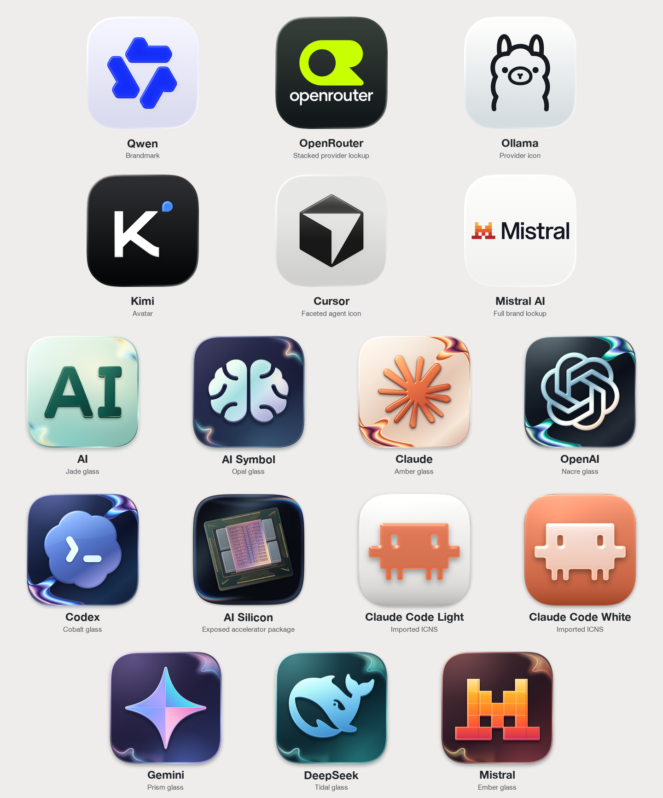

# AI glass icons

The collection contains 17 icons. Subscribe to the [app index](../../Apps.json) for both PNG sizes or the [144px index](../../Apps144px.json) for compact images.



## macOS 26 brand icons

| Icon | LobeHub form | PNG | macOS download | Icon Composer source |
| --- | --- | --- | --- | --- |
| Qwen | `brandmarks` | [1024px](png/qwen-brandmark.png) · [144px](144px/qwen-brandmark.png) | [ICNS](icns/qwen-brandmark.icns) | [Qwen project](source/qwen-brandmark.icon/) |
| OpenRouter | `ProviderCombine` | [1024px](png/openrouter-combine.png) · [144px](144px/openrouter-combine.png) | [ICNS](icns/openrouter-combine.icns) | [OpenRouter project](source/openrouter-combine.icon/) |
| Ollama | `ProviderIcon` | [1024px](png/ollama-provider.png) · [144px](144px/ollama-provider.png) | [ICNS](icns/ollama-provider.icns) | [Ollama project](source/ollama-provider.icon/) |
| Kimi | `Avatar` | [1024px](png/kimi-avatar.png) · [144px](144px/kimi-avatar.png) | [ICNS](icns/kimi-avatar.icns) | [Kimi project](source/kimi-avatar.icon/) |
| Cursor | `AgentIcon` | [1024px](png/cursor-agent.png) · [144px](144px/cursor-agent.png) | [ICNS](icns/cursor-agent.icns) | [Cursor project](source/cursor-agent.icon/) |
| Mistral AI | `IconCombine` | [1024px](png/mistral-combine.png) · [144px](144px/mistral-combine.png) | [ICNS](icns/mistral-combine.icns) | [Mistral project](source/mistral-combine.icon/) |

OpenRouter stacks its Volt monogram above the wordmark so the round opening remains visible at 32px. Cursor separates the cube’s upper facet into a second layer so it catches light independently. Mistral uses its current full logo on a neutral surface.

The PNGs and ICNS use the default macOS appearance. Open a local `.icon` project in Apple Icon Composer to edit its layers and preview other appearances. To export the Qwen icon from the repository root with Xcode 27.2 installed, run

```sh
ictool="/Applications/Xcode.app/Contents/Applications/Icon Composer.app/Contents/Executables/ictool"
"$ictool" logo/ai-glass/source/qwen-brandmark.icon --export-image \
  --output-file /tmp/qwen.png --platform macOS --rendition Default \
  --width 1024 --height 1024 --scale 1 --design-generation 26
```

### Artwork sources

The [LobeHub component guide](https://icons.lobehub.com/skills.md) and [component index](https://icons.lobehub.com/llms.txt) describe the six forms. The vector references below are pinned to LobeHub Icons 6.20.0. The [LobeHub MIT license](source/LICENSE-LobeHub.txt) accompanies the adapted paths. Brand marks belong to their respective owners.

- Qwen uses the three-part silhouette and blue fill from the [Qwen brandmark](https://github.com/lobehub/lobe-icons/blob/05260484d9f4de68f90cc87a634ae68fa4043efd/packages/static-svg/icons/qwen-color.svg).
- OpenRouter pairs the [symbol](https://github.com/lobehub/lobe-icons/blob/05260484d9f4de68f90cc87a634ae68fa4043efd/packages/static-svg/icons/openrouter-color.svg) and [lettering](https://github.com/lobehub/lobe-icons/blob/05260484d9f4de68f90cc87a634ae68fa4043efd/packages/static-svg/icons/openrouter-text.svg) in the proportions of [OpenRouter’s vertical lockup](https://openrouter.ai/brand/logos/transparent/vertical/svg/vertical-volt.svg).
- Ollama uses the linework of the [Ollama provider mark](https://github.com/lobehub/lobe-icons/blob/05260484d9f4de68f90cc87a634ae68fa4043efd/packages/static-svg/icons/ollama.svg).
- Kimi uses the [Kimi mark](https://github.com/lobehub/lobe-icons/blob/05260484d9f4de68f90cc87a634ae68fa4043efd/packages/static-svg/icons/kimi-color.svg) at the scale specified by [Kimi.Avatar](https://github.com/lobehub/lobe-icons/blob/05260484d9f4de68f90cc87a634ae68fa4043efd/src/Kimi/components/Avatar.tsx).
- Cursor uses the [cube mark](https://github.com/lobehub/lobe-icons/blob/05260484d9f4de68f90cc87a634ae68fa4043efd/packages/static-svg/icons/cursor.svg) selected by the [agent mapping](https://github.com/lobehub/lobe-icons/blob/05260484d9f4de68f90cc87a634ae68fa4043efd/src/features/agentConfig.ts).
- Mistral follows the [IconCombine form](https://icons.lobehub.com/features/icon-combine). Its pixel emblem, colors and lettering come from [Mistral’s current brand assets](https://mistral.ai/brand/).

## Earlier AI glass icons

| Icon | macOS | PNG | Editable artwork |
| --- | --- | --- | --- |
| AI · Jade Glass | [ICNS](icns/ai.icns) | [1024px](png/ai.png) · [144px](144px/ai.png) | [SVG](source/ai.svg) |
| AI Symbol · Opal Glass | [ICNS](icns/ai-symbol.icns) | [1024px](png/ai-symbol.png) · [144px](144px/ai-symbol.png) | [SVG](source/ai-symbol.svg) |
| Claude · Amber Glass | [ICNS](icns/claude.icns) | [1024px](png/claude.png) · [144px](144px/claude.png) | [SVG](source/claude.svg) |
| OpenAI · Nacre Glass | [ICNS](icns/openai.icns) | [1024px](png/openai.png) · [144px](144px/openai.png) | [SVG](source/openai.svg) |
| Codex · Cobalt Glass | [ICNS](icns/codex.icns) | [1024px](png/codex.png) · [144px](144px/codex.png) | [SVG](source/codex.svg) |
| AI Silicon | [ICNS](icns/ai-silicon.icns) | [1024px](png/ai-silicon.png) · [144px](144px/ai-silicon.png) | [Python renderer](source/ai-silicon.py) |
| Claude Code Liquid Glass Light | [Original ICNS](icns/claude-code-light.icns) | [1024px](png/claude-code-light.png) · [144px](144px/claude-code-light.png) | Supplied artwork |
| Claude Code Liquid Glass White | [Original ICNS](icns/claude-code-white.icns) | [1024px](png/claude-code-white.png) · [144px](144px/claude-code-white.png) | Supplied artwork |
| Gemini · Prism Glass | [ICNS](icns/gemini.icns) | [1024px](png/gemini.png) · [144px](144px/gemini.png) | [SVG](source/gemini.svg) |
| DeepSeek · Tidal Glass | [ICNS](icns/deepseek.icns) | [1024px](png/deepseek.png) · [144px](144px/deepseek.png) | [SVG](source/deepseek.svg) |
| Mistral · Ember Glass | [ICNS](icns/mistral.icns) | [1024px](png/mistral.png) · [144px](144px/mistral.png) | [SVG](source/mistral.svg) |

## Artwork

Two icons represent AI across providers. The jade monogram sits on pale celadon glass. The wordless symbol pairs two opalescent brain hemispheres on an indigo tile.

Claude pairs a copper starburst with a warm porcelain tile. OpenAI uses a mother-of-pearl knot over smoked graphite. The Codex terminal prompt sits inside a raised cobalt cloud. These three silhouettes come from the installed Claude and Codex applications.

Gemini uses a four-point prism, DeepSeek a whale, and Mistral a stepped pixel M. The glass finishes were drawn for this collection. Brand references are available from [Google Gemini](https://gemini.google.com/), [DeepSeek](https://www.deepseek.com/en/download/), and [Mistral AI](https://mistral.ai/brand/).

AI Silicon depicts an exposed accelerator package with a patterned compute die, four high-bandwidth memory stacks and gold traces. Its geometry and material lighting are procedurally drawn. From the repository root, run `python3 logo/ai-glass/source/ai-silicon.py` with NumPy and Pillow to regenerate the 1024px PNG. Use `rsvg-convert logo/ai-glass/source/claude.svg -o logo/ai-glass/png/claude.png` to render Claude. Substitute the matching filenames for the other SVG designs.

The two original ICNS files retain the bytes supplied as `Claude_Code_liquid_glass_Light_b3Yp5kFVQA-19ed537871.icns` and `Claude_Code_liquid_glass_white_BTBvaXMiCZ-0473a737d2.icns`. Their 1024px PNGs come directly from the embedded full-size images, and their 144px versions use the embedded 256px images.
