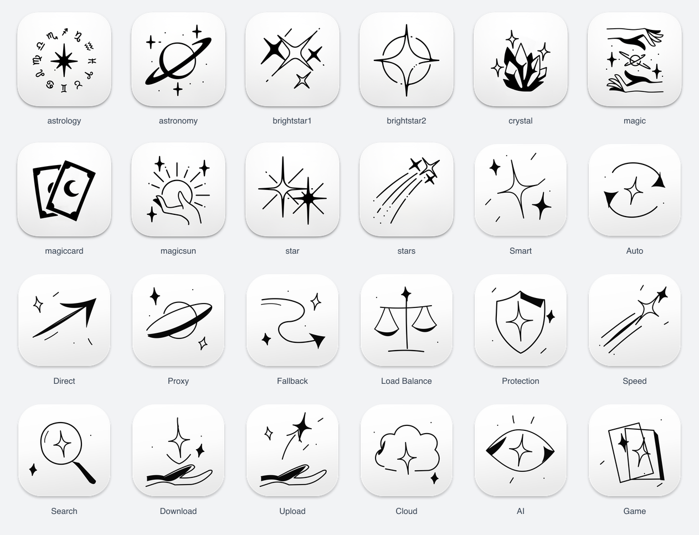

# Ink hand-drawn collection

[UI-Handdrawn-Ink.json](../../UI-Handdrawn-Ink.json) contains 24 images: ten original decorative black-ink images and fourteen new drawings. This is separate from the regular black line family at `signal/minimal/`.

## Preserved originals

The original `astrology`, `astronomy`, `brightstar1`, `brightstar2`, `crystal`, `magic`, `magiccard`, `magicsun`, `star` and `stars` PNGs remain byte-identical at `signal/`. They are existing repository assets; no new authorship or vector source is claimed for them.

## Extensions

New drawings use fluid curves, tapered filled ink accents, alternating solid/hollow starbursts, asymmetric small marks and sparse compositions. The hand and astronomy motifs continue the visual vocabulary of the original images. The new scenes are original SVG artwork, rather than traced copies of the supplied photographs or regular geometric line icons.

Subjects: Smart, Auto, Direct, Proxy, Fallback, Load Balance, Protection, Speed, Search, Download, Upload, Cloud, AI and Game. New exports are 1024px and 128px with transparent outer corners. The ten old files retain their original sizes and URLs.

Run `python3 signal/ink/build.py` to regenerate new SVGs and the index. Install `sharp`, then run `node signal/ink/render.cjs` and `node signal/ink/preview.cjs`. Only the fourteen new drawings are regenerated; the original ten raster files are never overwritten by these scripts.
