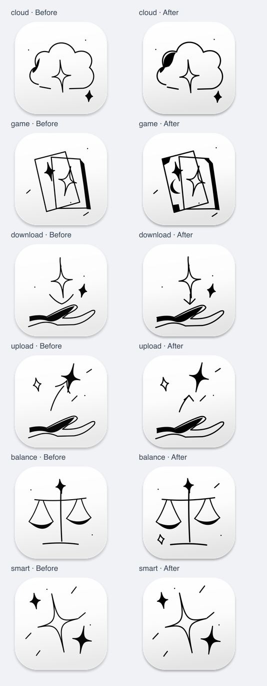

# 墨线手绘图标复核

对比基线：`3a7a41b`。范围：10 张保留原图、14 张新增图，以及 128px / 1024px 导出。

本轮方式为执行者逐图视觉复核与程序校验，不是独立第三方审稿，也没有实际代理客户端验收。

## 发现与修正

| 项目 | 修正前 | 本轮处理 | 复核结果 |
| --- | --- | --- | --- |
| 墨线与留白 | 部分新稿轮廓偏轻，和原图的黑白重量有落差 | 新稿改为纯黑墨色，空心轮廓增粗约 10%，保留填黑笔触和不规则曲线 | 大图下轮廓更稳定，未出现出界或裁切 |
| 底板与投影 | 新稿底部较亮、阴影较散 | 降低底部灰阶，缩短投影模糊并增加不透明度 | 新旧图集中的底板差异缩小 |
| Cloud / Game | 比较接近普通线框，缺少原图的实心/空心交替 | Cloud 加入不规则填黑笔触；Game 加入牌角和月牙的黑白层次 | 与原有星芒、魔法纸牌的视觉词汇更一致 |
| Download / Upload | 依赖星芒位置表达方向，容易混淆 | 接收改为下落箭头，发送改为上升箭头，均保留手势与星芒 | 大图方向清楚；小图仍需结合分组名称 |
| Load Balance | 对称线框偏规整 | 增加非对称的星芒、短笔触，主体略放大 | 更接近装饰墨线风格，秤盘仍可辨 |

## 技术校验

- 24 条索引均指向存在的文件，名称无重复。
- 14 张新增图在 128px / 1024px 两种尺寸下，SVG 渲染与 PNG 像素一致，共 28 对。
- 新稿边角透明，深色主体未触及画布边缘。
- 10 张原始 PNG 与基线逐字节一致。
- SG、其他国旗、App、规则线稿及 Relief 图集未改动。
- Python 源码可解析，Git 空白检查通过。

## 使用边界

这套图的目标是装饰性、具有手势感的墨线图标，不是极简系统符号。建议使用 128px 或更大尺寸。64px 可看出总体轮廓，但细点、短线和手指细节会丢失，不能据此声称所有图形在 32px / 64px 都能独立表意。

新稿为原创延展；本轮修正改善了风格连续性，不代表复刻了原作者的笔触，也不替代用户对最终美感的判断。
