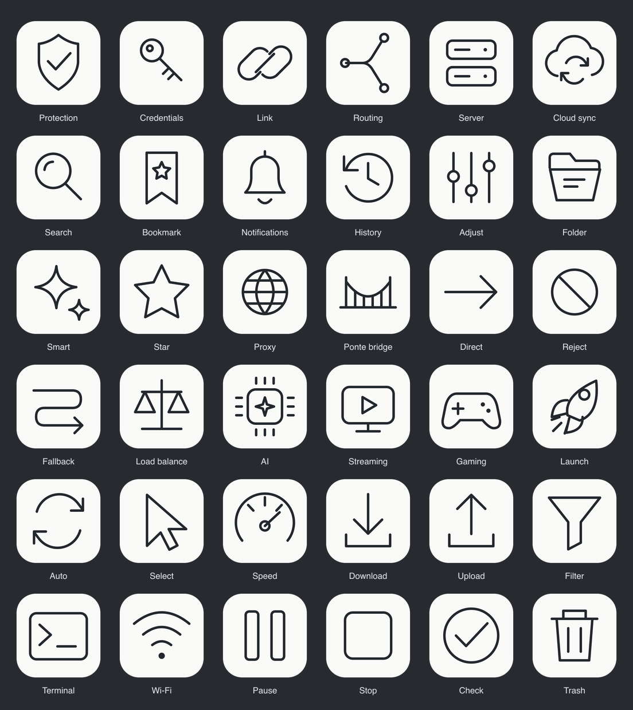

# Black line UI family

[UI-Minimal.json](../../UI-Minimal.json) contains 36 black line icons at 128px. Editable SVGs are in `source/` and larger exports are in `512/`.

The first 24 designs and their original PNG/SVG files are restored byte-for-byte from commit `16021cf`, where they were part of an experimental branch subsequently reverted by `4547c01`. Their URLs now point to `main`.

12 extensions continue the same 256-unit grid, `#23282E` ink, 7-unit rounded strokes and `#FAFAF9` tile: Auto, Select, Speed, Download, Upload, Filter, Terminal, Wi-Fi, Pause, Stop, Check, Trash. `manifest.json` separates restored subjects from extensions.

The decorative ink artworks (stars, magic, crystal, astronomy) remain at their original `signal/*.png` paths. [UI-Handdrawn-Ink.json](../../UI-Handdrawn-Ink.json) makes those ten existing images independently discoverable. Their source files have not been replaced or recolored.

To rebuild PNG exports, install `sharp` in Node's module path and run `node signal/minimal/render.cjs`. Rebuilding may change PNG encoding; the restored originals in this commit preserve the historical file bytes.
