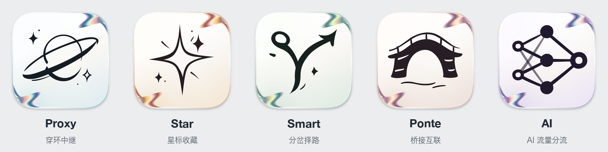

# Network policy group icons

Five network groups drawn in tapered ink on pale glass. Opposite corners carry the refracted colour. Use the [1024px index](../../Routing-Policy.json) or the [144px index](../../Routing-Policy144px.json).

[See the earlier designs and the current set at large size and 32px](comparison.png).

| Icon | Motif | PNG | Editable source |
| --- | --- | --- | --- |
| Proxy | A sweeping ink stroke crossing an open orbit | [1024px](1024/proxy.png) · [144px](144/proxy.png) | [SVG](source/proxy.svg) |
| Star | One hollow four-point star with a filled satellite | [1024px](1024/star.png) · [144px](144/star.png) | [SVG](source/star.svg) |
| Smart | A brushstroke forking into an open terminal and a heavier arrow | [1024px](1024/smart.png) · [144px](144/smart.png) | [SVG](source/smart.svg) |
| Ponte | A stone arch with sparse railings and two strokes of water | [1024px](1024/ponte.png) · [144px](144/ponte.png) | [SVG](source/ponte.svg) |
| AI | A feed-forward neural network on lavender glass. Nine ink connections link two input nodes, three hidden nodes, and one output node. | [1024px](1024/ai.png) · [144px](144/ai.png) | [SVG](source/ai.svg) |
