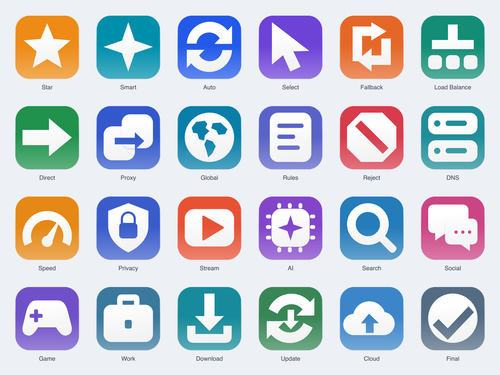

# Relief · Strategy Icons

24 original strategy symbols redesigned around large matte relief shapes. Two appearances share the same subjects and geometry: porcelain with graphite relief, and colored tiles with ivory relief. This replaces the earlier small layered Prism presentation.

## Files

- [Strategy.json](../Strategy.json) and [Strategy144px.json](../Strategy144px.json): porcelain / graphite, 1024px and 144px.
- [StrategyColor.json](../StrategyColor.json) and [StrategyColor144px.json](../StrategyColor144px.json): color / ivory, 1024px and 144px.
- `source/<name>.svg` and `source/<name>-color.svg`: editable static compositions.
- `layers/<name>/background.svg` and `glyph.svg`: unmasked square background and clean vector symbol, with true transparent cutouts and without baked lighting/shadows.

## Design

A single large symbol replaces the inset miniature illustrations. A subdued vertical material transition and a short, soft offset shadow suggest relief. The same shape carries both appearances. Symbols have optical sizing within a 186-unit envelope on a 256-unit design grid; the exported canvas is 1024 square, with rounded corners only in the static composition.

The native layer SVGs include the same centered symbol sizing as the static composition. The source symbol uses SVG luminance masks for transparent cutouts; there is no extra 87% scale step. Native import compatibility is not verified. The static source includes gradients, shadows and an enclosure; do not treat it as an unstyled native icon layer.

PNG exports are static artwork, not `.icon` packages or dynamic Liquid Glass. Icon Composer import, platform modes and device appearance have not been tested. The dark preview shows the same light icons against a dark surrounding surface, not a native dark theme.

References: [CapCut (Golden Gate, Dark), by xdan](https://macosicons.com/?icon=DAZC158WJJ) for the graphite relief treatment, and the user-supplied red/white icon for the large light relief symbol. These references inform material and proportions only; their logos and pixels are not redistributed. The original [Apple Icon Composer](https://developer.apple.com/icon-composer/) reference remains background context for source organization.

## Subjects

| Name | Use | File |
| --- | --- | --- |
| Star | 收藏 | [star.png](png/star.png) |
| Smart | 智能选择 | [smart.png](png/smart.png) |
| Auto | 自动测速 | [auto.png](png/auto.png) |
| Select | 手动选择 | [select.png](png/select.png) |
| Fallback | 故障转移 | [fallback.png](png/fallback.png) |
| Load Balance | 负载均衡 | [load-balance.png](png/load-balance.png) |
| Direct | 直连 | [direct.png](png/direct.png) |
| Proxy | 代理 | [proxy.png](png/proxy.png) |
| Global | 全局 | [global.png](png/global.png) |
| Rules | 规则分流 | [rules.png](png/rules.png) |
| Reject | 拦截 | [reject.png](png/reject.png) |
| DNS | 域名解析 | [dns.png](png/dns.png) |
| Speed | 速度优先 | [speed.png](png/speed.png) |
| Privacy | 隐私保护 | [privacy.png](png/privacy.png) |
| Stream | 流媒体 | [stream.png](png/stream.png) |
| AI | 人工智能 | [ai.png](png/ai.png) |
| Search | 搜索 | [search.png](png/search.png) |
| Social | 社交 | [social.png](png/social.png) |
| Game | 游戏 | [game.png](png/game.png) |
| Work | 工作 | [work.png](png/work.png) |
| Download | 下载 | [download.png](png/download.png) |
| Update | 更新 | [update.png](png/update.png) |
| Cloud | 云服务 | [cloud.png](png/cloud.png) |
| Final | 兜底 | [final.png](png/final.png) |

## Rebuild

Run `python3 strategy/scripts/build.py`, then install `sharp` and run `node strategy/scripts/render.cjs`. Run `node strategy/scripts/preview.cjs` for contact sheets. The rendering script embeds origin metadata in the exported icon PNGs.

Original artwork follows the repository license. Earlier versions remain in Git history.
