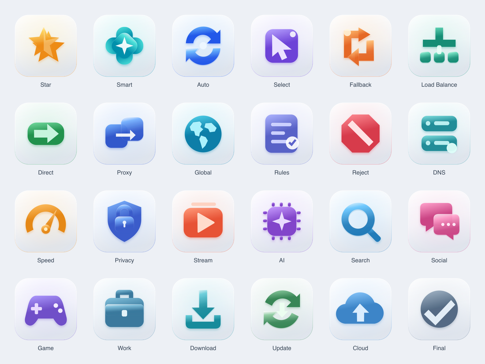

# Prism · Strategy Icons

24 original strategy-group icons inspired by Apple's layered icon design. This collection is independent of the existing App, UI and flag collections.

## Use

- [Strategy.json](../Strategy.json): 24 direct links to 1024 × 1024 PNGs.
- [Strategy144px.json](../Strategy144px.json): the same 24 icons indexed as 144 × 144 PNGs.
- [png/](png/): flattened material previews for proxy clients and other image consumers.
- [144px/](144px/): matching smaller PNG exports.
- [source/](source/): composite SVGs with the rounded enclosure, centered 87% glyph scale, gradients, edge highlights, and static shadows used by the PNG exports.
- [layers/](layers/): unmasked, unlit source layers. Each icon includes an opaque square background plus separate back/front artwork; some include an accent.

## Design and scope

The common design uses a pale porcelain surface, a floating colored rear layer, and a translucent or frosted foreground. Each subject is distinct at small sizes. Color is secondary to silhouette; no letters or emoji are used inside the icons. The static exports intentionally simulate depth with top illumination, crisp edge highlights, and offset soft shadows.

These PNG/SVG exports are **not native `.icon` packages** and do not contain dynamic Liquid Glass, real-time refraction, or system appearance annotations. They have not been imported or tested in Icon Composer or validated on a device. The light/dark contact sheets show the same default artwork against two surrounding colors; there are no native dark or monochrome variants.

For a native Icon Composer project, import the unmasked files in `layers/<name>/` in background, back, front, accent order. The back, front, and accent SVGs use the same 256-unit coordinate system but retain the authored geometry at 100%. The composite `source/<name>.svg` scales those three artwork layers together to 87% around the canvas center; the full-canvas background is not scaled. Apply that centered 87% group scale if the native composition must match the static export. Then use Icon Composer for masking, specular lighting, translucency, and shadow. Do not import the composite SVG or flattened PNG as native layer artwork because both already contain the rounded enclosure and static material treatment.

References: [Icon Composer](https://developer.apple.com/icon-composer/) and [Apple's App icons guidance](https://developer.apple.com/design/human-interface-guidelines/app-icons/), consulted 2026-10-12. All artwork in this collection is newly authored; Apple reference images are not distributed in this repository.

## Icon map

| Name | Meaning | File |
| --- | --- | --- |
| Star | 收藏 · 五角星，收藏与优选 | [star.png](png/star.png) |
| Smart | 智能选择 · 四瓣感应器与中心星芒，智能选择 | [smart.png](png/smart.png) |
| Auto | 自动测速 · 双向循环箭头，自动探测 | [auto.png](png/auto.png) |
| Select | 手动选择 · 指针与选择面板，手动切换 | [select.png](png/select.png) |
| Fallback | 故障转移 · 转向备用路径的双折线箭头 | [fallback.png](png/fallback.png) |
| Load Balance | 负载均衡 · 一入三出，负载分配 | [load-balance.png](png/load-balance.png) |
| Direct | 直连 · 直达箭头，直接连接 | [direct.png](png/direct.png) |
| Proxy | 代理 · 相互覆盖的网络节点与穿越箭头 | [proxy.png](png/proxy.png) |
| Global | 全局 · 球体与抽象大陆，全局路由 | [global.png](png/global.png) |
| Rules | 规则分流 · 规则文档与完成标记 | [rules.png](png/rules.png) |
| Reject | 拦截 · 八边形禁行标记 | [reject.png](png/reject.png) |
| DNS | 域名解析 · 双层解析服务器 | [dns.png](png/dns.png) |
| Speed | 速度优先 · 测速表盘与指针 | [speed.png](png/speed.png) |
| Privacy | 隐私保护 · 盾牌与锁，隐私和安全 | [privacy.png](png/privacy.png) |
| Stream | 流媒体 · 视频播放卡片 | [stream.png](png/stream.png) |
| AI | 人工智能 · 芯片与计算星核，AI 服务 | [ai.png](png/ai.png) |
| Search | 搜索 · 放大镜，搜索服务 | [search.png](png/search.png) |
| Social | 社交 · 交叠对话气泡，社交服务 | [social.png](png/social.png) |
| Game | 游戏 · 游戏手柄，低延迟游戏 | [game.png](png/game.png) |
| Work | 工作 · 公文包，工作服务 | [work.png](png/work.png) |
| Download | 下载 · 下载箭头与托盘 | [download.png](png/download.png) |
| Update | 更新 · 双循环箭头与状态点，系统更新 | [update.png](png/update.png) |
| Cloud | 云服务 · 云与上传箭头，云端同步 | [cloud.png](png/cloud.png) |
| Final | 兜底 · 终点确认，默认兜底策略 | [final.png](png/final.png) |

## Rebuild

Run `python3 strategy/scripts/build.py` from any directory. Install `sharp` in your Node environment, then run `node strategy/scripts/render.cjs`. The Python source defines all 24 geometries and writes the manifest, layer artwork, composite SVGs and collection index. The Node script produces both PNG sizes. Use Python 3.9 or later.

Original artwork follows the repository license. Sources and previews are provided for further customization.
